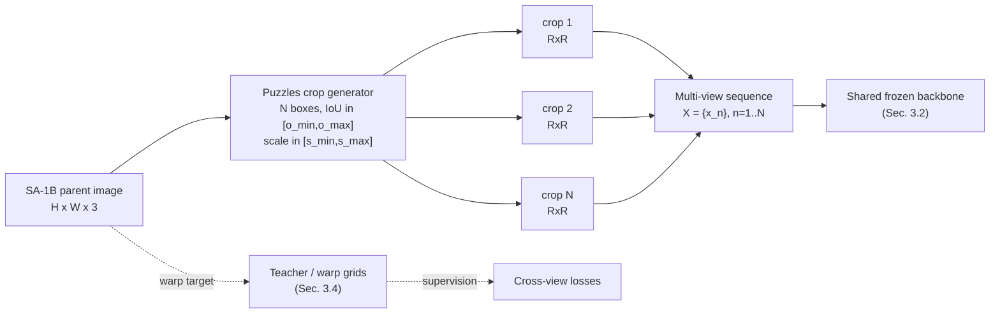
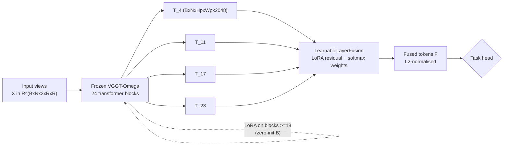
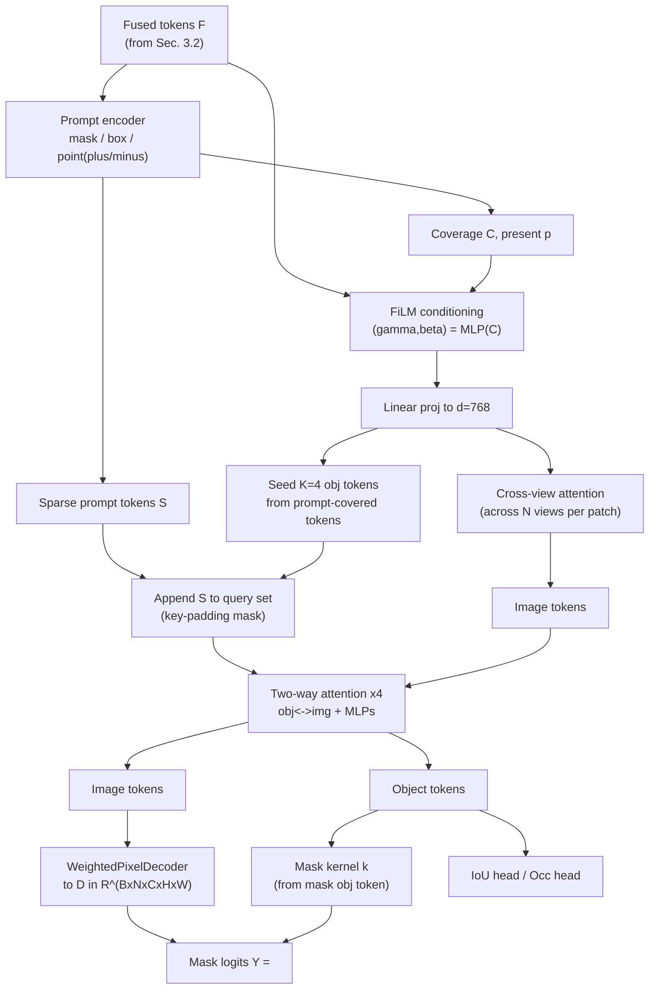
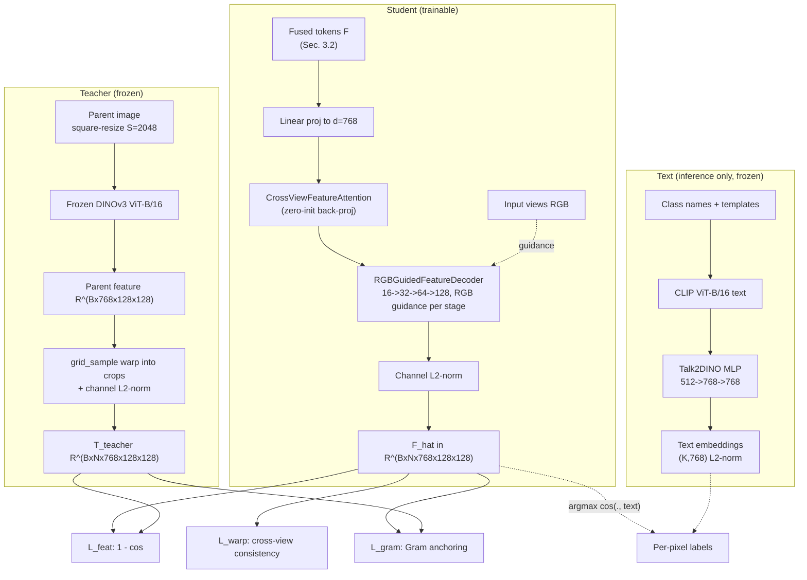
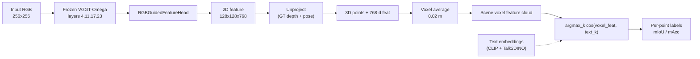

# Method

We present **Puzzles**, a training framework that turns the single-image SA-1B dataset into synthetic multi-view supervision, and instantiate it for two tasks: (i) **promptable multi-view segmentation** (Sec. 3.3) and (ii) **open-vocabulary 3D segmentation** (Sec. 3.4). Both share a frozen multi-view backbone and a learnable layer-fusion module (Sec. 3.1–3.2); they differ in their task head, objective and — for the second task — an additional distillation teacher. Implementation details are summarised in Sec. 3.5. Network modules are illustrated as flowcharts in Figures 1–5.

## 3.1 The Puzzles Single-Image Multi-Crop Recipe

A key difficulty in learning multi-view-consistent representations from SA-1B is that the dataset offers only **single-image** masks — there is no video, no multi-view capture, and no cross-view correspondence. The Puzzles recipe synthesises a multi-view sequence from each SA-1B parent image at no additional labelling cost.

**Crop generation.** Given a parent image of size $H \times W$, we sample $N$ overlapping crop boxes $\{b_n\}_{n=1}^{N}$, $b_n=(x_1,y_1,x_2,y_2)$, in parent-image pixel coordinates. Each box side length is a fraction $s \in [s_{\min}, s_{\max}]$ of the parent's shorter side (default $s \in [0.5, 0.9]$), and the **pairwise IoU with previously sampled boxes is constrained to $[o_{\min}, o_{\max}]$** (default $[0.7, 0.95]$). The high-overlap constraint ensures every crop pair shares a large common region, so a warp between any two crops is well-defined almost everywhere. Each crop is resized to a square of resolution $R$ ($R{=}256$ for segmentation, $R{=}224$ for the streaming variant), and the $N$ crops form one multi-view sample $\mathbf{X}=\{x_n\}_{n=1}^{N}$, $x_n \in \mathbb{R}^{3 \times R \times R}$, fed to the shared backbone as a sequence.

**Free cross-view supervision.** Because each crop's pixel grid is a known affine map of the parent image, we can (i) warp a teacher feature computed on the **whole parent image** into each crop's frame (Sec. 3.4), and (ii) warp a student feature from crop $i$ into crop $j$ and enforce consistency on the overlap. No multi-view RGB-D or video data is used; the only inputs are the SA-1B image and its masks. Geometric and occlusion augmentation are disabled (they would break the pixel-accurate student–teacher correspondence the losses rely on); only photometric augmentation is retained.

**Curriculum.** A scheduler linearly relaxes the overlap range from $[0.70, 0.95]$ at the start of training to $[0.10, 0.50]$ near the end, so the model first learns near-duplicate views and is gradually exposed to harder, less-overlapping pairs.

**Figure 1.** The Puzzles single-image multi-crop recipe. One SA-1B parent image is decomposed into $N$ overlapping crops that form a synthetic multi-view sequence; crop-box geometry provides the warp grids used for free cross-view supervision.

## 3.2 Frozen VGGT-Omega Backbone with Layer-Selective LoRA

Both tasks use the **VGGT-Omega** aggregator, a 24-block multi-view transformer whose patch tokens encode strong geometry and cross-view matching. We freeze the backbone and extract patch tokens from a fixed subset of cached blocks $\mathcal{L}=\{4,11,17,23\}$, yielding a token list $\{\mathbf{T}_\ell\}_{\ell\in\mathcal{L}}$ with $\mathbf{T}_\ell \in \mathbb{R}^{B \times N \times H_p \times W_p \times 2048}$.

**Layer-selective LoRA.** For segmentation we inject low-rank adapters into the attention/MLP linear layers of the aggregator, **only into blocks with index $\geq 18$**. Blocks $0$–$17$ remain pristine and continue to serve the separate depth/camera reconstruction heads; the LoRA-adapted tail $\{18,\dots,23\}$ specialises toward segmentation. The rank is scheduled progressively: base rank $r{=}16$ for early blocks, $\times 2$ for mid blocks ($\geq 12$) and $\times 4$ for late blocks ($\geq 18$), with inter-frame (cross-view) blocks receiving an additional $\times 2$ since they carry the cross-view matching signal the task depends on. $\alpha$ is scaled with $r$ so the effective scaling $\alpha/r$ is constant. Every adapter's down-projection $\mathbf{B}$ is **zero-initialised**, so the adapter contribution is exactly zero at the start of fine-tuning and the backbone reproduces its pre-trained behaviour; disabling the adapters restores the exact reconstruction backbone, enabling a safe two-pass inference (reconstruction with LoRA off, segmentation with LoRA on).

**LearnableLayerFusion.** The four cached token tensors are combined by a small trainable module. For each layer $\ell$ it adds a LoRA-style residual $\Delta_\ell = (\mathbf{T}_\ell \mathbf{A}_\ell)\mathbf{B}_\ell$ ($\mathbf{A}_\ell$ zero-init, $\mathbf{B}_\ell$ small-random) to the L2-normalised tokens, then takes a softmax-weighted sum across layers (uniform at init). This makes the representation task-aware without back-propagating into the heavy backbone, starting from a faithful reproduction of the training-free equal-weight fusion baseline.

**Figure 2.** Shared backbone. The frozen VGGT-Omega aggregator (with layer-selective zero-init LoRA on blocks $\geq 18$) produces cached patch tokens from four layers, which are fused by `LearnableLayerFusion` into a single task-aware token tensor consumed by either task head.

## 3.3 Promptable Multi-View Segmentation

This method achieves the best results on promptable-segmentation benchmarks (NVOS, SPIn-NeRF, ESAMBench, IGGT instance tracking, nuScenes multi-view tracking). It is a single, generalisable, feed-forward network trained **only on single-image SA-1B-style masks** — no video and no multi-view supervision — yet it fuses prompts across views in one forward pass.

### 3.3.1 Architecture

Given views $\mathbf{X} \in \mathbb{R}^{B \times N \times 3 \times H \times W}$, prompts $\mathbf{P}$ and masks $\mathbf{G} \in \mathbb{R}^{B \times N \times M \times H \times W}$, the model $\mathcal{M}_{\text{seg}} = \text{Head}_{\text{seg}} \circ \text{Backbone}_{\text{LoRA}}$ processes the fused tokens in five stages:

1. **LearnableLayerFusion** (Sec. 3.2) yields fused, L2-normalised tokens $\mathbf{F} \in \mathbb{R}^{B \times N \times H_p \times W_p \times 2048}$.
2. **Prompt encoder** (SAM-style) converts heterogeneous prompts — masks, boxes, points with $\pm$ labels — into (a) a dense coverage map $\mathbf{C} \in \mathbb{R}^{B \times N \times M \times H_p \times W_p}$ and a present flag $\mathbf{p} \in \{0,1\}^{B \times N \times M}$, and (b) a small set of sparse prompt tokens $\mathbf{S} \in \mathbb{R}^{B \times N \times M \times S \times d}$. A prompt may be placed on **any subset of views** for an instance (multi-view prompting, sampled with probability $p_{\text{mv}}$).
3. **FiLM prompt conditioning** modulates the fused tokens per (view, instance): for every prompted $(n,m)$, $\mathbf{F}_n$ is transformed by a coverage-dependent affine $(\gamma_{n,m}, \beta_{n,m}) = \text{MLP}(\mathbf{C}_{n,m})$; unprompted pairs pass through unchanged. The modulated tokens are linearly projected to the work dimension $d{=}768$.
4. **Cross-view attention** runs self-attention across the $N$ view-tokens at each spatial patch (complexity $\mathcal{O}(N^2)$ per patch). This lets the prompt-conditioned signal in the prompted view(s) propagate *directly* to every other view, rather than being squeezed through the $K$ object-token bottleneck.
5. **Two-way attention decoder** stacks $L_{\text{tw}}{=}4$ SAM-style blocks. $K{=}4$ object tokens per (view, instance) are seeded from the prompt-covered tokens aggregated across **all** prompted views; sparse prompt tokens are appended to the query set (with a key-padding mask so padded prompts are ignored). Each block lets object tokens attend image tokens and then image tokens attend object tokens, followed by MLPs on both. 3D positional encoding from depth+pose is added to the image tokens when geometry is available.

The decoder produces a dense feature map $\mathbf{D} \in \mathbb{R}^{B \times N \times C \times H \times W}$ via a `WeightedPixelDecoder` (per-layer projection + softmax-weighted fusion + ConvTranspose upsampling), and a dynamic mask kernel $\mathbf{k} \in \mathbb{R}^{B \times N \times M \times C}$ from the mask object token. Mask logits are $\mathbf{Y} = \langle \mathbf{D}, \mathbf{k} \rangle$ (einsum over channels). Auxiliary heads regress an IoU score and an occlusion logit per (view, instance).

**Figure 3.** Promptable multi-view segmentation head. Heterogeneous prompts from any view are encoded, injected via FiLM, propagated across views by cross-view attention, and decoded by a SAM-style two-way decoder into per-view masks via a dynamic mask kernel.

### 3.3.2 Training Objective

We train with a direct 1:1 prompt–GT correspondence (the $m$-th prompt and the $m$-th GT mask describe the same instance). The total loss is

$$\mathcal{L}_{\text{seg}} = \lambda_{\text{bce}}\mathcal{L}_{\text{bce}} + \lambda_{\text{dice}}\mathcal{L}_{\text{dice}} + \lambda_{\text{iou}}\mathcal{L}_{\text{iou}} + \lambda_{\text{occ}}\mathcal{L}_{\text{occ}} + \lambda_{\text{consist}}\mathcal{L}_{\text{consist}} + \lambda_{\text{pt}}\mathcal{L}_{\text{pt}},$$

with defaults $\lambda_{\text{bce}} = \lambda_{\text{dice}} = 5$, $\lambda_{\text{iou}} = 1$, $\lambda_{\text{occ}} = 0.2$, $\lambda_{\text{consist}} = 0.01$, $\lambda_{\text{pt}} = 1$:

- **$\mathcal{L}_{\text{bce}}, \mathcal{L}_{\text{dice}}$**: pixel-wise BCE-with-logits and Dice loss between $\sigma(\mathbf{Y})$ and $\mathbf{G}$ over all views (GT masks are propagated to *every* view, not just the prompted one, so the head is forced to predict consistently across views).
- **$\mathcal{L}_{\text{iou}}$**: MAE between the predicted IoU scalar and the real mask IoU (a SAM-style quality head).
- **$\mathcal{L}_{\text{occ}}$**: BCE on whether the GT mask is non-empty on a given view (occlusion head).
- **$\mathcal{L}_{\text{consist}}$**: cross-view L2 variance of the mask object token — for the same instance, the $N$ views' mask tokens should stay close to their cross-view centroid, since they describe the same physical object.
- **$\mathcal{L}_{\text{pt}}$**: point supervision — for point prompts, the predicted probability is pushed high at positive points and low at negative points via bilinear-sampled BCE, so negative points actively suppress the predicted region.

### 3.3.3 Multi-Prompt Inference

At inference, prompts from **any** view (mask, box, point, or point-with-negatives) are jointly encoded and fused across all views in a single forward pass; predicted masks are returned for every view simultaneously. Because the backbone is shared and frozen, the same network also drives depth/camera reconstruction (with LoRA disabled), yielding a unified feed-forward model that needs **no per-scene optimisation** — in contrast to per-scene NeRF/3DGS baselines (SPIn-NeRF, SA3D, SAGA, OmniSeg3D) which must fit each test scene individually. The method scales to long sequences (up to 248 frames in a single forward pass) without OOM, whereas clustering-based baselines (e.g. IGGT's HDBSCAN) are $\mathcal{O}(N^2)$ and OOM on 100+ frames.

## 3.4 Open-Vocabulary 3D Segmentation via DINOv3 Distillation

This method is evaluated on the EmbodiedSplat open-vocabulary 3D segmentation benchmark (ScanNet 10/15/19, ScanNet200, ScanNet++). It augments the frozen VGGT-Omega backbone with a lightweight **RGBGuidedFeatureHead** that predicts dense features aligned to a frozen **DINOv3 + Talk2DINO** teacher, so that per-pixel features can be classified against arbitrary text at inference.

### 3.4.1 RGBGuidedFeatureHead

The head consumes the same token list $\{\mathbf{T}_\ell\}_{\ell\in\mathcal{L}}$ and proceeds as:

1. **LearnableLayerFusion** (shared with the seg head) $\to$ fused tokens $\mathbf{F} \in \mathbb{R}^{B \times N \times H_p \times W_p \times 2048}$.
2. **Linear projection** to work dim $d{=}768$.
3. **CrossViewFeatureAttention**: the dense-feature analogue of the seg head's cross-view attention (no instance dimension) — at each patch, the $N$ view-tokens attend each other so the per-view feature maps become cross-view consistent. The cross-view output is added through a **zero-initialised** back-projection, so training starts identical to the no-cross-view path and learns to inject cross-view information.
4. **RGBGuidedFeatureDecoder**: a multi-stage ConvTranspose upsampler ($16 \to 32 \to 64 \to 128$) that, at every $2\times$ stage, concatenates a lightweight RGB guidance feature (a shared 2-conv stem applied to the input image resized to that scale) with the upsampled token features and fuses them. This is the JAFAR-style "image guides feature upsampling" idea adapted to a conv decoder, and is what yields **image-sharp** feature boundaries at $128 \times 128$.
5. **Channel L2 normalisation** along the channel axis, so cosine similarity against the (similarly normalised) teacher reduces to a dot product.

Output: $\hat{\mathbf{F}} \in \mathbb{R}^{B \times N \times 768 \times 128 \times 128}$, channel-L2-normalised.

### 3.4.2 DINOv3 + Talk2DINO Teacher

The teacher is fully frozen and runs on the fly during training (no pre-cached features):

- **Visual tower.** The parent image is square-resized to a long side $S{=}2048$ and passed through a frozen DINOv3 ViT-B/16 (`forward_intermediates`, final-norm dense patch tokens), giving a parent feature map in $\mathbb{R}^{B \times 768 \times 128 \times 128}$. Because the parent feature grid spans the whole parent image, a view's crop box maps to normalised grid coordinates via $(p_x / W, p_y / H)$; the aspect-ratio distortion of the square-resize does not misalign the teacher. The parent feature is `grid_sample`-warped into each Puzzles crop box and channel-L2-normalised to produce the per-view teacher target $\mathbf{T}_{\text{teacher}} \in \mathbb{R}^{B \times N \times 768 \times 128 \times 128}$.
- **Text tower (inference only).** For open-vocabulary classification, class names are templated with an ImageNet-style prompt ensemble, encoded by a frozen OpenAI CLIP ViT-B/16 (QuickGELU) text tower, and projected into the DINOv3-768 space by a frozen Talk2DINO MLP ($512 \to 768 \to 768$, tanh activations). The text embeddings are L2-normalised. Classification is then $\arg\max_k \cos(\hat{\mathbf{F}}, \text{text}_k)$.

Only the visual DINOv3 tower is needed at training time; the Talk2DINO text projection is used for evaluation / demo.

**Figure 4.** Open-vocabulary 3D segmentation via DINOv3 distillation. A trainable `RGBGuidedFeatureHead` (left) predicts dense features distilled from a frozen DINOv3 visual teacher (right) via cosine, warp-consistency and Gram losses. At inference, features are classified against arbitrary text through a frozen CLIP + Talk2DINO text projection.

### 3.4.3 Stage 1 — SA-1B Pre-training

The head is first trained from scratch on SA-1B with the Puzzles recipe, distilling the frozen DINOv3 teacher. The loss is

$$\mathcal{L}_{\text{stage1}} = \lambda_{\text{feat}}\mathcal{L}_{\text{feat}} + \lambda_{\text{warp}}\mathcal{L}_{\text{warp}} + \lambda_{\text{gram}}\mathcal{L}_{\text{gram}},$$

with defaults $\lambda_{\text{feat}} = 1.0$, $\lambda_{\text{warp}} = 0.1$, $\lambda_{\text{gram}} = 0.5$:

- **$\mathcal{L}_{\text{feat}}$ (pixel-wise cosine).** $1 - \cos(\hat{\mathbf{F}}, \mathbf{T}_{\text{teacher}})$, averaged over valid teacher pixels. Both feature maps are channel-L2-normalised, so cosine is a dot product.
- **$\mathcal{L}_{\text{warp}}$ (cross-view consistency).** For overlapping view pairs $(i, j)$, the student feature of view $i$ is warped into view $j$'s frame (using the crop-box-derived warp grid, no extra supervision) and pulled toward $\text{stop-grad}(\hat{\mathbf{F}}_j)$ on the overlap. The overlap mask is determined purely in parent-image coordinates: a view-$j$ pixel is valid for pair $(i, j)$ iff its parent coordinate falls inside view $i$'s crop box. Pairs are subsampled to `max_warp_pairs` for efficiency.
- **$\mathcal{L}_{\text{gram}}$ (Gram anchoring, DINOv3-style).** For a random subset of $K{=}512$ pixels (shared across the batch), we build the $K \times K$ matrix of pairwise cosine similarities for both student and teacher ($\mathbf{G} = \mathbf{S}\mathbf{S}^\top$) and penalise $\|\mathbf{G}_{\text{pred}} - \mathbf{G}_{\text{teacher}}\|^2$. Because each view's teacher is the parent DINOv3 feature warped into that view, $\mathbf{G}_{\text{teacher}}$ encodes the *original-image* similarity structure over the region the view covers; matching it (a) preserves sharp cross-boundary dissimilarity (anti-blur) and (b) enforces cross-scale / cross-view consistency of that structure. This is the adaptation of DINOv3 Gram anchoring to the Puzzles warp setup.

This stage produces a feed-forward `RGBGuidedFeatureHead` that predicts DINOv3-aligned features with **no scene optimisation**.

### 3.4.4 Stage 2 — ScanNet Fine-tuning (open vocabulary)

To make the features discriminative for a concrete vocabulary, we fine-tune on ScanNet with a **per-pixel text-aligned cross-entropy** that directly trains the feature to match text at open-vocab inference:

- **Label warping.** The parent ScanNet label map (NYU40 ids, $-1$ void) is warped into each Puzzles crop box with nearest sampling, using the *same* normalised grid as the feature warping, so labels stay pixel-aligned with the predicted features.
- **Text-CE.** For each pixel, $\text{logits}_k = \cos(\hat{\mathbf{F}}, \text{text}_k) / \tau$ ($\tau{=}0.07$) over the vocabulary classes, and cross-entropy is taken against the warped GT class index (ignoring $-1$ void). This is the loss that makes the feature discriminative for the vocabulary used at open-vocab inference (text matching).
- **Class balancing (A+B scheme).** To handle the long-tailed ScanNet class distribution we apply (a) per-class inverse-frequency weights derived from frame counts (effective class-balanced weights with $\beta{=}0.999$) and (b) focal-CE modulation $(1 - p_t)^\gamma$ with $\gamma{=}2.0$ to up-weight hard / rare pixels.
- **Auxiliary vocabularies.** A multi-head text-CE is used: the main NYU40 head ($\lambda_{\text{ce}}$) plus auxiliary ScanNet20 ($\lambda_{\text{ce20}}{=}0.5$) and, in the distilled variant, ScanNet200 and ScanNet++ 20-class heads. The auxiliary heads share the same feature map and are projected against their respective (L2-normalised) text embeddings. Warping the *same* parent label through different id$\to$idx mappings lets one feature serve multiple benchmarks.
- **Distilled single net.** The strongest variant ("Ours (SN200, SN++)") is a *single* distilled head trained jointly on ScanNet test (oracle SN200/NYU40/SN20 2D labels) + ScanNet++ test (oracle SN++ 20-class 2D labels, official `semantic_classes.txt` mapping), initialised from the Stage-1 + ScanNet200 fine-tune. One head is then evaluated on *all* benchmarks (ScanNet 10/15/19/200 + ScanNet++ 20). The joint SN++ supervision boosts the shared features beyond the per-benchmark specialists.

The Stage-1 distillation losses (cosine + warp + Gram) are kept active during fine-tuning so the feature stays anchored to the DINOv3 teacher while becoming text-discriminative.

### 3.4.5 3D Lifting and Open-Vocab Inference

At evaluation (EmbodiedSplat protocol) the per-frame 2D features are lifted to 3D and classified with no test-time optimisation:

1. **Per-frame 2D features.** Each input RGB ($256 \times 256$) $\to$ frozen VGGT-Omega backbone (layers 4, 11, 17, 23) $\to$ `RGBGuidedFeatureHead` $\to$ $128 \times 128 \times 768$ feature, channel-L2-normalised, aligned to DINOv3/Talk2DINO text space.
2. **3D lifting (GT depth/pose).** Each pixel is unprojected via GT depth + camera pose into a 3D point carrying its 768-d feature. Per-point features are voxel-averaged across all frames at voxel size $0.02$ m to form a scene voxel feature cloud. The per-frame merge is vectorised via `searchsorted` to keep memory bounded.
3. **Open-vocab classification.** GT points are assigned to the nearest voxel and inherit the voxel feature; each point is labelled by $\arg\max_k \cos(\text{voxel\_feat}, \text{text\_embed}(\text{class}_k))$. mIoU / mAcc are computed over the classes present in GT, matching EmbodiedSplat's `evaluate()`.

**Figure 5.** Open-vocabulary 3D inference pipeline. Per-frame 2D features are unprojected with GT depth+pose, voxel-averaged into a scene feature cloud, and classified against arbitrary text embeddings by cosine-argmax, with no test-time optimisation.

The whole pipeline is feed-forward, generalisable and online: $\sim$15.16 ms/frame for backbone+head, $\sim$5.5 s for a 363-image scene, with no per-scene reconstruction loop (vs. minutes-to-hours for per-scene 3DGS/NeRF baselines and $\sim$8 min/scene for EmbodiedSplat's online loop).

## 3.5 Implementation Details

**Shared.** Frozen VGGT-Omega aggregator; cached blocks $\mathcal{L}=\{4,11,17,23\}$; token dim 2048; work dim 768; mixed-precision bfloat16; AdamW optimiser; cosine LR with linear warmup; DDP across 8$\times$A800 GPUs; periodic `checkpoint-last.pth` (every `save_steps`) and best-by-val `checkpoint-best.pth`.

**Promptable segmentation (Sec. 3.3).** $N{=}6$ views at $518 \times 518$ (scalable to 248 frames at inference); head work dim 768, $K{=}4$ object tokens, $L_{\text{tw}}{=}4$ two-way layers, 8 heads, pixel-out 96; cross-view attention + 3D geom PE on; multi-view prompting prob $p_{\text{mv}}{=}0.5$; prompt modalities $\{\text{mask}, \text{box}, \text{point}\}$; max 6 points per point-prompt. Backbone LoRA: base rank 16, base $\alpha$ 16, `start_layer` 18, inter-frame $\times 2$. Loss weights as in Sec. 3.3.2. Trained on SA-1B single-image masks only.

**Open-vocab 3D segmentation (Sec. 3.4).** Stage 1 (SA-1B): $N{=}6$ views at $256 \times 256$, `feature_res` 128, `feature_out` 768, RGB guidance 32-ch stem, $\lambda_{\text{feat}}{=}1.0$, $\lambda_{\text{warp}}{=}0.1$, $\lambda_{\text{gram}}{=}0.5$, `gram_samples` 512, `max_warp_pairs` 12. Stage 2 (ScanNet fine-tune, "AB"): 106 train scenes ($\sim$1671 frames) with NYU40/ScanNet20 labels, batch 12, 12 epochs, lr $5\text{e}{-5}$, init from the SA-1B checkpoint; class-balanced focal text-CE ($\gamma{=}2.0$, $\beta{=}0.999$). Distilled variant: 60 epochs, joint ScanNet + ScanNet++ oracle labels. Streaming variant (lingbot-map backbone): $N{=}16$ views at $224 \times 224$ (multiple of `patch_size` 14 $\to$ $16 \times 16$ patch grid), `num_frame_for_scale` 2, `max_warp_pairs` 16. Inference: stride 10, voxel $0.02$ m, 11 ScanNet test scenes (10 for SN200), ScanNet++ 4 test scenes zero-shot; single checkpoint, no TTA / no ensemble.

**Checkpoints.** Promptable seg best: `output/.../checkpoint-best.pth`. Open-vocab: SA-1B-only head $\to$ `output/feat_dinov3/checkpoint-best.pth`; distilled single net $\to$ `output/feat_dinov3_scannet_oracle_mixed_v2/checkpoint-best.pth`.

> **Note on figures.** Figures 1–5 are rendered as Mermaid flowcharts for the draft. For the final ICLR submission (LaTeX), each should be redrawn as a vector figure (e.g. TikZ or PDF) with consistent typography; the module boundaries and data-flow arrows above map directly onto such figures.
